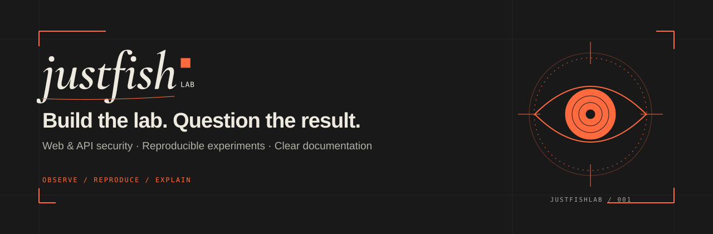

<p align="center"></p>

# Security labs

**Pertanyaan kecil. Eksperimen terkontrol. Bukti yang bisa diperiksa.**

Kumpulan lab lokal dari [JustFishLab](https://justfishlab.my.id) yang menghubungkan pertanyaan keamanan, source yang bisa dijalankan, hasil, perbaikan, dan batas eksperimen.

[English / dokumentasi teknis lengkap](README.md) · [Studi kasus](https://justfishlab.my.id/notes/access-control-lab) · [Tes otomatis](https://github.com/justfishlab2/security-labs/actions/workflows/tests.yml)

## Jalankan

Prasyarat: Node.js 22 atau lebih baru dan Git. Tanpa dependency pihak ketiga, API key, Docker, atau target eksternal.

```sh
git clone https://github.com/justfishlab2/security-labs.git
cd security-labs
npm test
npm run lab:001
```

Tidak perlu `npm install`. Server sementara hanya mendengarkan di `127.0.0.1` pada port acak, menjalankan empat request, menulis `artifacts/lab-001.json`, lalu berhenti.

## Lab 001 / Otorisasi objek

Satu catatan sintetis dimiliki `account-a`. Dua identitas simulasi diakui oleh lab. Endpoint pertama tidak memeriksa pemilik; endpoint kedua memeriksanya.

| Mode | Akun | Status yang diharapkan |
| :--- | :--- | :---: |
| Tanpa pemeriksaan pemilik | A | `200` |
| Tanpa pemeriksaan pemilik | B | `200` |
| Dengan pemeriksaan pemilik | A | `200` |
| Dengan pemeriksaan pemilik | B | `403` |

**`X-Lab-User` adalah header simulasi, bukan autentikasi.** Klien bisa mengubahnya. Karena itu endpoint protected tetap bukan API aman siap produksi. Aplikasi nyata perlu memperoleh identitas dari sesi/token terverifikasi dan menerapkan aturan pemilik, tenant, serta peran.

Sepuluh tes memeriksa empat kombinasi utama, tidak dikembalikannya isi catatan saat dilarang, identitas kosong/tidak dikenal, objek/rute tidak ada, metode tidak didukung, dan binding loopback. CI menjalankan tes pada Node 22 dan 24.

## Asal bukti

- `evidence/original-run.mjs`: script asli eksperimen privat di VPS milik sendiri.
- `evidence/vps-original.json`: bukti request/response sintetis asli; timestamp mengikuti jam lingkungan eksekusi.
- `labs/001-object-authorization/`: versi pembelajaran hasil refactor, dengan rute eksplisit dan tes regresi.
- `artifacts/`: keluaran baru dari eksekusi lokal, bukan bukti historis. Folder ini diabaikan Git.

Refactor mempertahankan perbandingan empat request dan menambahkan penanganan metode, rute, serta objek yang hilang. Keduanya tidak diklaim sebagai implementasi identik.

Untuk menjalankan ulang versi asli:

```sh
mkdir -p artifacts
npm run lab:original
```

## Batas penggunaan

Lab ini tidak menguji autentikasi nyata, database, race condition, caching, atau seluruh kemungkinan bypass. Jangan dipasang sebagai layanan internet. Tidak ada pengujian target pihak ketiga, klaim bounty, atau data pengguna nyata dalam fixture ini.

Jangan mengirim secret, data privat, atau kerentanan yang belum diizinkan ke issue publik. Baca [panduan keamanan](SECURITY.md) dan [kontribusi](CONTRIBUTING.md).

## Selanjutnya

- [x] Publikasi eksperimen kepemilikan objek dan bukti sintetis.
- [x] Versi lab yang dapat dijalankan dan tes otomatis.
- [ ] Matriks otorisasi dua tenant.
- [ ] Perbandingan berbasis peran.
- [ ] Studi kasus berikutnya setelah diuji dan didokumentasikan.

## Lisensi dan referensi

Kode dan dokumentasi orisinal: [MIT](LICENSE). Wordmark turunan font mengikuti [SIL OFL](assets/Cormorant-OFL.txt); lihat [kredit aset](assets/NOTICE.md).

Referensi: [OWASP BOLA](https://owasp.org/API-Security/editions/2023/en/0xa1-broken-object-level-authorization/) · [Authorization Cheat Sheet](https://cheatsheetseries.owasp.org/cheatsheets/Authorization_Cheat_Sheet.html)
