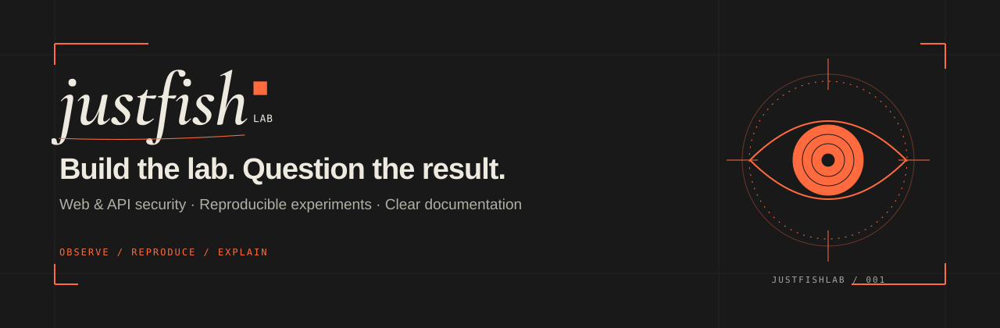

<p align="center"></p>

<p align="center">
  <a href="https://github.com/justfishlab2/security-labs/actions/workflows/tests.yml"></a>
  &nbsp; <a href="LICENSE">MIT-licensed code</a> &nbsp; / &nbsp;
  <a href="https://justfishlab.my.id/notes">Case studies</a> &nbsp; / &nbsp;
  <a href="README.id.md">Bahasa Indonesia</a>
</p>

# Security labs

**Small questions. Controlled experiments. Inspectable evidence.**

A growing collection of local web and API security labs from [JustFishLab](https://justfishlab.my.id). Each published experiment connects a security question to runnable code, an observed result, a relevant mitigation, and an explicit set of limitations.

This is a learning and documentation repository—not a collection of real-target exploits, undisclosed vulnerabilities, or bounty claims.

## Start here

| Lab | Question | Implementation | Case study |
| :--- | :--- | :--- | :--- |
| **001 · Object authorization** | Can account B read account A’s note after a successful identity check? | [Code & tests](labs/001-object-authorization/) | [Read the journal](https://justfishlab.my.id/notes/access-control-lab) |
| **002 · Tenant isolation** | Can tenant B read tenant A’s project? | [Code & policy](labs/002-tenant-isolation/) | [Read the journal](https://justfishlab.my.id/notes/tenant-isolation) |
| **003 · Role authorization** | Can a member call an admin export function? | [Code & policy](labs/003-role-authorization/) | [Read the journal](https://justfishlab.my.id/notes/role-authorization) |

## Quick start

**Requirements:** Node.js 22 or newer, Git. No third-party runtime dependencies, API keys, accounts, Docker, or external targets.

```sh
git clone https://github.com/justfishlab2/security-labs.git
cd security-labs
npm test
npm run lab:001
npm run lab:policies
```

`npm install` is not required. The lab starts a temporary HTTP server on `127.0.0.1` with an OS-assigned port, makes four local requests, writes a result file, and shuts down.

Generated output: `artifacts/lab-001.json` (ignored by Git). To choose another output path:

```sh
node labs/001-object-authorization/run.mjs artifacts/my-run.json
```

## Labs 002 & 003 / Tenant and role boundaries

`npm run lab:policies` executes both new experiments using the shared loopback fixture. See the per-lab READMEs above for identity mappings, expected outcomes, and limitations. The complete suite currently contains **24 tests** across all three labs; the original VPS policy capture is `evidence/policy-vps.json`.

## Lab 001 / The ownership boundary

An identity check answers **“who is making the request?”** An authorization check must also answer **“may that actor access this particular object?”**

The fixture contains one synthetic note owned by `account-a`. Two mock identities are accepted by the lab. Both endpoints recognize the same identities; only one checks object ownership.

```text
GET /unprotected/notes/note-alpha   identity check → return note
GET /protected/notes/note-alpha     identity check → owner check → allow / deny
```

### Expected comparison

| Mode | Actor | Resource owner | Expected HTTP | Meaning |
| :--- | :--- | :--- | :---: | :--- |
| Unprotected | `account-a` | `account-a` | `200` | Legitimate read succeeds. |
| Unprotected | `account-b` | `account-a` | `200` | Cross-account disclosure is deliberately demonstrated. |
| Protected | `account-a` | `account-a` | `200` | The relevant fix preserves legitimate access. |
| Protected | `account-b` | `account-a` | `403` | The ownership check denies the other account. |

> **Important:** `X-Lab-User` is a client-controlled mock identity header. It is intentionally convenient for a local experiment and is **not authentication**. A production system must derive identity from a verified session/token and enforce the appropriate ownership, role, and tenant policy. The protected endpoint is not a production-ready secure API.

### What the tests cover

The suite uses Node’s built-in test runner and checks:

- The four actor/mode comparisons above.
- No note body is returned with the forbidden response.
- Missing and unknown mock identities receive `401`.
- Unknown objects and unknown routes receive `404`.
- Unsupported methods receive `405`.
- The server binds to IPv4 loopback only.

GitHub Actions runs the suite on Node.js **22 and 24**. A passing workflow supports these narrow behaviors; it does not prove the absence of other vulnerabilities.

### Remediation principle

Use a verified identity and scope data access to the actor’s authorization context. For example:

```js
// Illustrative production pattern, not the implementation in this lab.
const note = await db.note.findFirst({
  where: { id: requestedId, ownerId: session.userId },
});
if (!note) return notFound();
```

The right response policy may use `403` or a non-disclosing `404`, depending on the application. Unpredictable identifiers do not replace access control. Real systems also need policy decisions for shared resources, roles, tenants, and administrative access.

## Evidence and provenance

Two implementations are intentionally distinguished:

| File | Purpose |
| :--- | :--- |
| [`evidence/original-run.mjs`](evidence/original-run.mjs) | Preserved one-shot script used for the original owned-VPS experiment. |
| [`evidence/vps-original.json`](evidence/vps-original.json) | Original captured synthetic request/response evidence, also published in the portfolio article. The timestamp is the execution environment’s recorded clock. |
| [`labs/001-object-authorization/`](labs/001-object-authorization/) | Refactored teaching version with explicit routes, an exported server, cleanup, and regression tests. |
| `artifacts/lab-001.json` | Fresh local output generated when you run the refactored version; not the historical capture. |

The refactor preserves the four-case comparison and adds explicit method, route, and missing-object handling. It is not presented as byte-identical to the historical script.

To rerun the preserved original script locally:

```sh
mkdir -p artifacts
npm run lab:original
```

No third-party account, customer record, private target, or real visitor IP is included in these fixtures.

## Limitations and safety

- Local, synthetic teaching setup only; do not expose either version as an internet-facing service.
- No real authentication, database, session management, or multi-tenant model.
- The protected example still trusts the mock identity header; an actor can change it. That is outside the demonstrated owner-check comparison, not a hidden security guarantee.
- Not a test of caching, races, rate limiting, token validation, or every access-control bypass.
- Do not point this repository at third-party systems without explicit authorization.
- Never attach secrets, private findings, production logs, or personal data to public issues.

See [SECURITY.md](SECURITY.md) for reporting guidance.

## Repository map

```text
.github/workflows/tests.yml       Minimal-permission CI, Node 22 + 24
assets/                          Original banner and font-derived asset notices
docs/LAB-TEMPLATE.md              Structure for future experiments
evidence/                        Original script and synthetic VPS capture
labs/001-object-authorization/   Refactored lab, runner, regression tests
CONTRIBUTING.md                  Expectations for non-sensitive contributions
SECURITY.md                      Safety scope and reporting guidance
```

## Roadmap

- [x] Publish the original ownership-check experiment and synthetic evidence.
- [x] Add a runnable teaching version and automated regression tests.
- [x] Extend the fixture with a two-tenant authorization matrix.
- [x] Add a role-based comparison with explicit expected permissions.
- [ ] Publish the next case study only after its behavior is tested and documented.

## Contributing

Small improvements to clarity, tests, and reproducibility are welcome. Start with [CONTRIBUTING.md](CONTRIBUTING.md). New labs should follow the [lab template](docs/LAB-TEMPLATE.md) and clearly identify intentionally unsafe behavior.

## References

- [OWASP API1:2023 — Broken Object Level Authorization](https://owasp.org/API-Security/editions/2023/en/0xa1-broken-object-level-authorization/)
- [OWASP Authorization Cheat Sheet](https://cheatsheetseries.owasp.org/cheatsheets/Authorization_Cheat_Sheet.html)
- [Node.js test runner](https://nodejs.org/api/test.html)

## License

Code and original repository documentation: [MIT](LICENSE). The font-derived wordmark retains the [SIL Open Font License notice](assets/Cormorant-OFL.txt); see [asset credits](assets/NOTICE.md).

---

[Portfolio](https://justfishlab.my.id) · [Lab journal](https://justfishlab.my.id/notes) · [GitHub profile](https://github.com/justfishlab2) · [Contact](mailto:hello@justfishlab.my.id)
